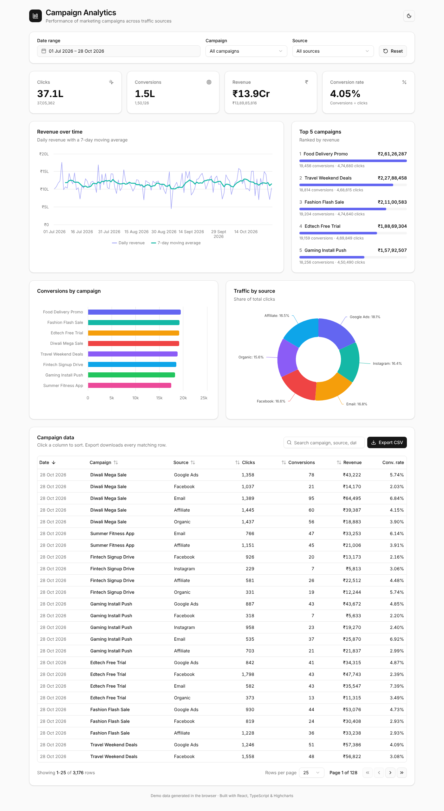
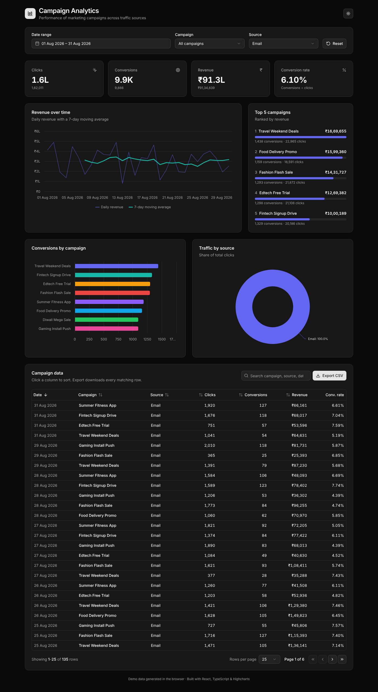
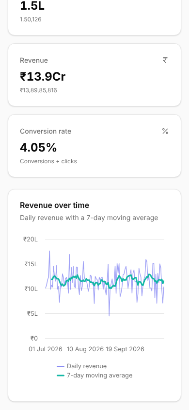

# Campaign Analytics Dashboard

A fast, responsive marketing analytics dashboard built with **React, TypeScript, shadcn/ui and Highcharts**. It tracks clicks, conversions and revenue for 3,000+ campaign records, and its core data features use hand-written algorithms (merge sort, binary search, min-heap, sliding window, LRU cache) instead of libraries.

**Live demo:** _add your Vercel link here_



## Features

- **KPI cards:** total clicks, conversions, revenue and conversion rate
- **Interactive Highcharts charts**
  - Revenue over time, with a 7-day moving average line
  - Conversions by campaign (bar chart)
  - Traffic share by source (donut chart)
- **Top 5 campaigns by revenue**, ranked with a min-heap
- **Filters:** shadcn date range picker (2-month calendar), campaign and source selects. Every chart, KPI and the table update together.
- **Data table with 3,000+ rows:** debounced search, sorting on any column, pagination (10/25/50/100 rows)
- **CSV export** of all filtered rows, done fully in the browser
- **Dark / light mode** using shadcn CSS variables, saved in localStorage, following the OS setting on first visit
- **Responsive layout** for mobile, tablet and desktop
- **Accessible:** Radix-based components with keyboard support, labelled inputs, `aria-sort` on table headers, Highcharts accessibility module

## Tech stack

| Area | Tools |
| --- | --- |
| UI | React 19, TypeScript (strict mode) |
| Components | shadcn/ui (Radix UI primitives), lucide-react icons |
| Build | Vite |
| Charts | Highcharts + highcharts-react-official |
| Styling | Tailwind CSS v4 |
| Testing | Jest, React Testing Library, ts-jest |
| Hosting | Vercel |

## DSA concepts used

All algorithms live in [`src/algorithms`](src/algorithms). Each file explains the logic and its Big-O cost, and each one has unit tests.

| Concept | Where it is used | Time | Space |
| --- | --- | --- | --- |
| **Merge sort** (stable) | Sorting table columns | O(n log n) | O(n) |
| **Binary search** (lower/upper bound) | Date-range filter on date-sorted data | O(log n) | O(1) |
| **Hash map aggregation** | Totals per campaign and per source | O(n) | O(k) |
| **Pagination** | Rendering one table page at a time | O(page size) | O(page size) |
| **Min-heap / priority queue** | Top 5 campaigns by revenue | O(n log k) | O(k) |
| **Sliding window** | 7-day moving average on the revenue chart | O(n) | O(n) |
| **Memoization + LRU cache** | Re-using results for repeated filter combinations | O(1) lookup | O(cache size) |
| **Debounce** | Table search runs only after typing pauses (300 ms) | O(1) per call | O(1) |

## UI with shadcn/ui

The interface uses [shadcn/ui](https://ui.shadcn.com) components (Card, Button, Select, Table, Popover, Calendar, Skeleton, Input, Label). shadcn/ui copies the component source into `src/components/ui`, so every component can be read and customised. Colours come from CSS variables in `src/index.css`; change `--primary` to rebrand the whole app. New components can be added with `npx shadcn@latest add <name>` (configured in `components.json`).

## Performance

- `useMemo` makes sure derived data (filtering, grouping, Top-K, moving average) is recalculated only when its inputs change. Switching the theme does not re-filter the data.
- `React.memo` on presentational components avoids unnecessary re-renders.
- Charts are **lazy-loaded** with `React.lazy` + `Suspense`, and Highcharts is split into its own cached chunk, so KPIs, filters and the table show up first.
- Only one page of table rows is in the DOM at any time.

## Project structure

```
src/
├── algorithms/      # Hand-written DSA (merge sort, binary search, heap, ...) + tests
├── components/      # Dashboard components + tests
│   ├── ui/          # shadcn/ui components (button, card, select, table, calendar, ...)
│   └── charts/      # Highcharts charts (lazy-loaded)
├── lib/             # cn() class-name helper used by shadcn/ui
├── data/            # Seeded mock data generator
├── hooks/           # useFilters, useDashboardData, useTableData, useTheme, useDebouncedValue
├── types/           # Shared TypeScript types
├── utils/           # Formatting, dates, CSV export, filtering, sorting, KPIs + tests
├── App.tsx          # Page layout
└── main.tsx         # Entry point
```

## Getting started

Requirements: Node.js 20 or newer.

```bash
git clone https://github.com/shakruddin/campaign-analytics-dashboard.git
cd campaign-analytics-dashboard
npm install
npm run dev        # open http://localhost:5173
```

| Command | What it does |
| --- | --- |
| `npm run dev` | Start the development server |
| `npm test` | Run all Jest tests |
| `npm run build` | Type-check and create the production build in `dist/` |
| `npm run preview` | Preview the production build locally |

## Screenshots

| Dark mode | Mobile |
| --- | --- |
|  |  |

## Deployment

The project is ready for Vercel (`vercel.json` is included): import the GitHub repository on vercel.com and click **Deploy**. Vercel detects Vite automatically.

## Note on data

The data is generated in the browser by a seeded random generator in `src/data/mockData.ts`, so it is realistic and the same on every load. No real customer data is used.

## Author

**Shakruddin Pathan**, Frontend Developer · [LinkedIn](https://www.linkedin.com/in/shakruddin-pathan-a1765a14b) · [GitHub](https://github.com/shakruddin)
# campaign-analytics-dashboard
